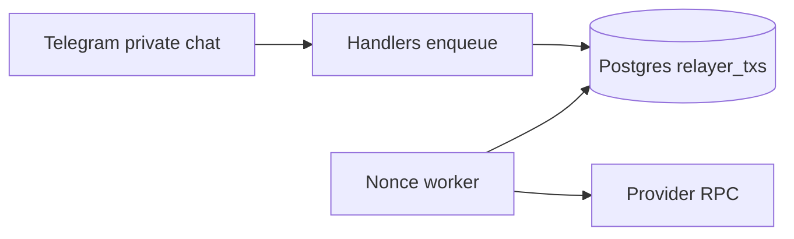

# Amoy Telegram USDC bot

A private-chat Telegram bot that turns `send 5 USDC to @maya` into a confirmed test-USDC transfer on Polygon Amoy and replies with a Polygonscan link.

The user's key never sends a transaction. It signs an EIP-2612 permit. One relayer key pays gas and calls `PaymentRouter.transferWithPermit`. Handlers only enqueue work. One worker allocates every relayer nonce from Postgres, commits the signed transaction, and only then broadcasts it.



## What you need

- A BotFather token
- A provider RPC for Polygon Amoy (Alchemy, Infura, or equivalent). The public Amoy endpoint is rate-limited and will not keep up with the rebroadcast loop
- POL on the relayer address only
- `KEY_ENCRYPTION_KEY` (`openssl rand -hex 32`)
- Optional `OPENAI_API_KEY`. Without it, the only accepted sentence is `send <amount> USDC to @name`

Anvil is for tests. It is not the demo chain.

## Contracts

```bash
cd contracts
forge install foundry-rs/forge-std --no-commit
forge install OpenZeppelin/openzeppelin-contracts@v5.1.0 --no-commit
forge test
export DEPLOYER_PRIVATE_KEY=0x...
export RELAYER_PRIVATE_KEY=0x...
forge script script/Deploy.s.sol --rpc-url "$RPC_URL" --broadcast
```

`forge test` and `forge script` both need `forge-std`. The script creates `contracts/deployments/` if it is missing, then writes `deployments/<chainid>.json`.

`Deploy.s.sol` deploys `MockUSDC` (6 decimals, permit, minter role) and `PaymentRouter`. The router cap is fixed at 100 USDC. The bot reads `maxTransfer()` at startup and uses that same cap. The deployer key is the contract owner and is not given to the running bot.

## Database and base nonce

```bash
cp .env.example .env
# fill the values, with CHAIN_ID=80002
uv sync
uv run alembic upgrade head
uv run python -m bot init-base-nonce <current-relayer-transaction-count>
```

`init-base-nonce` can run once, and only while the relayer table is empty. It reads the relayer's transaction count from the chain and accepts the number you pass only when the two are equal. A value ahead of the chain is rejected, so the first send cannot sit on a future nonce. After that, the worker assigns the next nonce as the highest committed nonce plus one. It does not take later nonces from `eth_getTransactionCount`. That call is only used to notice mined transactions and to refuse to start if a nonce was used outside this table.

## Run

```bash
uv run python -m bot
```

Or, on a small VPS:

```bash
docker compose up -d --build
```

Run `init-base-nonce` before the first send. Inside Compose that is `docker compose run --rm bot init-base-nonce <n>`. The image installs from `uv.lock`, and the service does not receive `DEPLOYER_PRIVATE_KEY`. Keep a single bot replica. The worker holds the relayer nonce.

## Talking to the bot

Open a private chat.

- `/start` creates one wallet and queues one starter mint. A later `/start` returns the same wallet.
- `send 5 USDC to @maya` asks you to confirm. Nothing is signed before Confirm.
- A message with an amount and no mention shows a contact button. The button's request id is stored on that transfer, so the person you pick is the recipient, including someone with no username.
- `/balance`, `/history`, `/faucet`

The confirm card shows the recipient's first name and the date this bot last saw that username. A username is not treated as current just because it is in the message.

## Modules

Built one at a time. A later module is not treated as done while an earlier one is still failing.

1. Contracts. `MockUSDC` and `PaymentRouter`, covered by `forge test`.
2. Parsing, amounts, and key encryption. No chain and no database.
3. Postgres. Users, one wallet per user, transfer intents, and the relayer nonce tables.
4. Chain client. Boot checks, mint, balance, and an EIP-2612 permit against a fresh Anvil.
5. Relayer worker. Nonce order, commit-before-broadcast, fee bumps, cancels, and the sender's result message.
6. Telegram handlers.
7. Amoy deploy and the live bot. Not done.

## Tests

```bash
make test
```

Pytest needs Postgres on `127.0.0.1:5432` with database `pay_test`, user `pay`, password `pay`, and Anvil at `~/.foundry/bin/anvil`. Both are required. A missing Anvil fails the chain and worker tests instead of skipping them.

```bash
createdb -h 127.0.0.1 -U pay pay_test
foundryup   # provides ~/.foundry/bin/anvil
```

Foundry covers the router, including a permit submitted directly to the token and a router call after the deadline. Pytest covers amount parsing, key encryption, username clearing, the one-open-transfer index, and the Anvil relayer lifecycle: crash after commit, a result that is still delivered after a later error in the same tick or a restart, fee bump, the original hash mining after a replacement, cancel after the deadline, a pause that keeps reconciling, a simulation error that fails one transfer instead of blocking the queue, and a startup refusal when a nonce has no receipt.

## Design

See [docs/design.md](docs/design.md) for parsing, key management, and what happens when a transaction fails or sticks.
